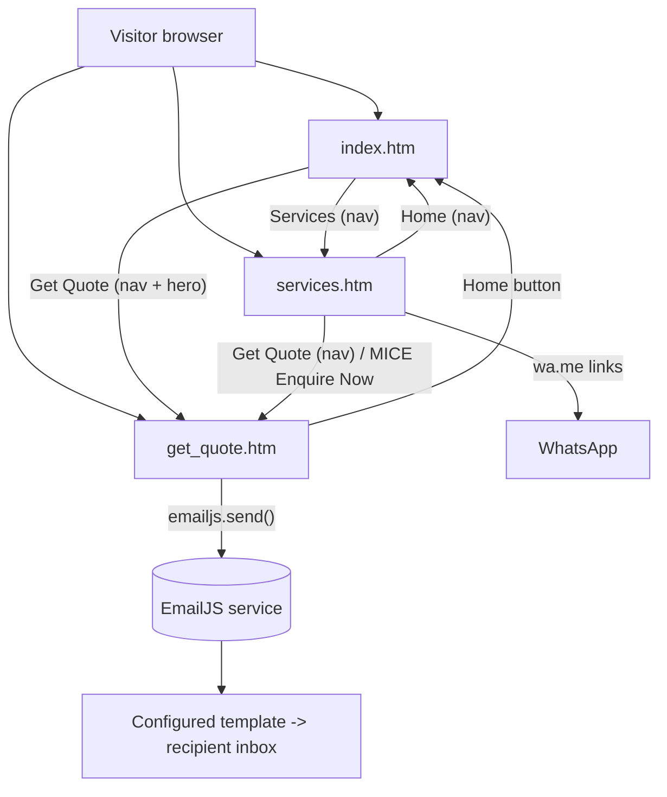
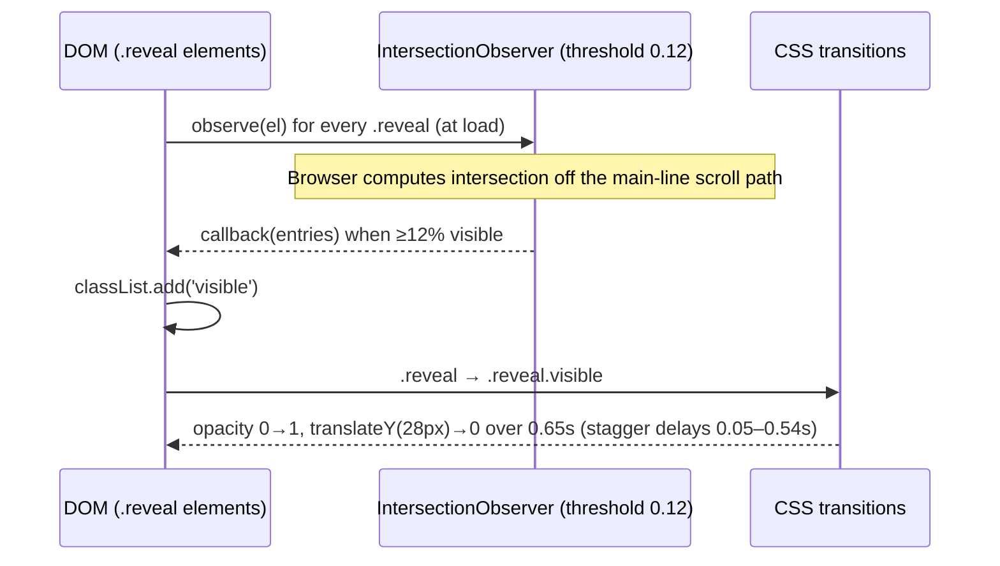
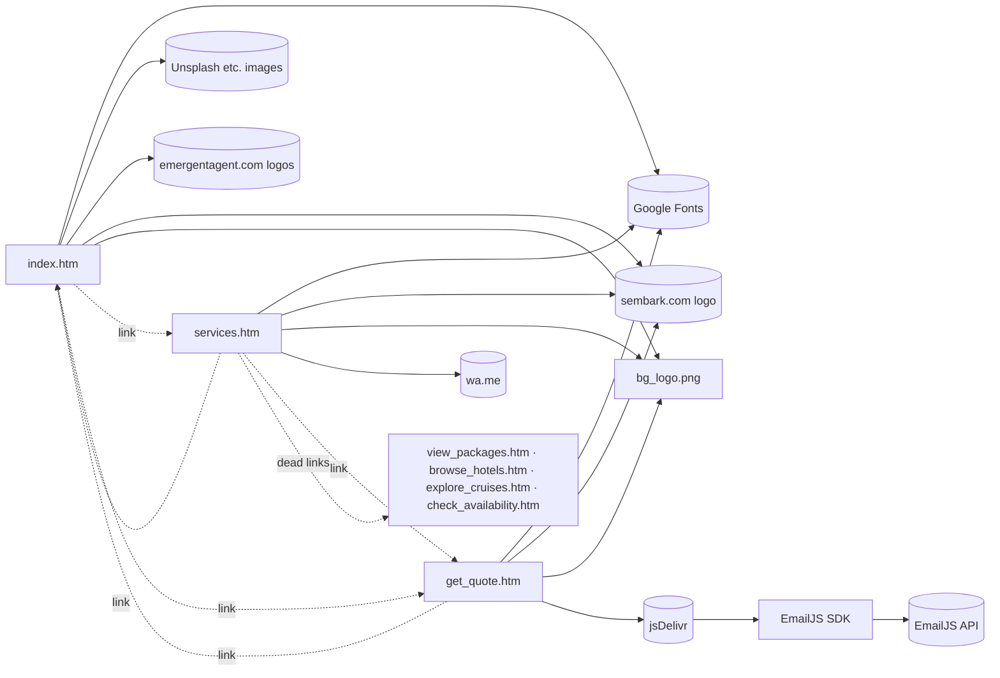

# TheVietnamDMC — Master Technical Context Document

**Author & repository owner:** Apurva Swarnkaar (GitHub: `HELOSIS09`) · **Repository:** `HELOSIS09/TheVietnamDMC`

> **Audience:** human developers and AI coding assistants (Claude, GPT, Cursor, Gemini, etc.).
> **Rule of this document:** the SOURCE CODE is the source of truth. Every claim is tagged where it matters:
>
> | Tag | Meaning |
> |---|---|
> | **[SRC]** | Verified directly from `index.htm`, `services.htm` or `get_quote.htm` |
> | **[REPO]** | Verified from the repository file listing / GitHub metadata |
> | **[INFER]** | Reasonable inference, not directly proven by code |
> | **[FUTURE]** | Recommendation / proposal — does NOT exist today |
> | **[UNVERIFIED]** | Could not be confirmed from the repository as inspected |

---
## 0. Repository identity and inspection scope

- Project name (use this everywhere): **TheVietnamDMC**
- Author: **Apurva Swarnkaar**
- Author / repository owner: **Apurva Swarnkaar** (GitHub user `HELOSIS09`)
- Repository: `https://github.com/HELOSIS09/TheVietnamDMC` (default branch `master`, public) **[REPO]**
- GitHub Pages site: `https://helosis09.github.io/TheVietnamDMC/` **[REPO]**
- Note: the repository contents were inspected when the repo was still published under its earlier name; this document uses the `TheVietnamDMC` name throughout. The GitHub repo and Pages URL only match these paths once the repository is named `TheVietnamDMC` on GitHub.

**What was inspected:** the full source of `index.htm` (594 lines), `services.htm` (840 lines), `get_quote.htm` (661 lines), the previous `README.md` (16 lines, marketing summary only), and the root file listing.

**What could NOT be inspected:**
- The contents of `.github/workflows/` — the directory exists in the listing **[REPO]**, but its files were not readable during inspection. Anything about deployment automation is therefore **[UNVERIFIED]** (see §14).
- Binary contents of `bg_logo.png` and `white_logo.jpg` (only their existence and references were checked).
- The EmailJS dashboard (template body, recipient address, service provider, allowed-origins, rate limits). These live outside the repo.
- Runtime behaviour in real browsers. Where CSS behaviour is reasoned from parsing rules rather than observed, it is marked **[INFER]**.

---

## 1. What is this project?

TheVietnamDMC is a **static, three-page, B2B marketing website** for a Vietnam destination management company (DMC). It presents the company's positioning, destinations, services, and a **quote-request form** that sends an email through EmailJS. **[SRC]**

- **Problem it addresses:** gives travel agents / tour operators a branded web presence and a low-friction way to send a Vietnam ground-package enquiry. **[INFER from copy]**
- **Intended user:** B2B travel agents, tour operators, corporate/MICE clients. The form is headed "Agent & Company Details" and "B2B Partner Portal"; the footer says "B2B only". **[SRC]**
- **Apparent target market:** India-based agents. Evidence in copy: phone placeholder `+91 98xxx xxxxx`, "Visa … for Indian travelers", "Contracted Indian Restaurants", Pure Veg / Jain / Gujarati menus, `+91` WhatsApp numbers. **[SRC]** (the conclusion itself is **[INFER]**)
- **It is NOT a booking system, portal, or platform.** See §16.

---

## 2. Architecture (actual)

**Pattern:** static multi-page site (MPA). Each page is one self-contained `.htm` file with an inline `<style>` block. Only two pages contain JavaScript (`services.htm`, `get_quote.htm`); `index.htm` has **no** `<script>` at all. **[SRC]**

```
Browser
  ↓  (HTTP GET, plain files; no server-side rendering)
Static HTML documents  ── index.htm | services.htm | get_quote.htm
  ↓
Inline <style> per page  (no shared stylesheet, no build)
  ↓
Vanilla JavaScript (only on 2 pages)
  ├─ services.htm  → IntersectionObserver scroll-reveal
  └─ get_quote.htm → form validation + EmailJS call
  ↓
External services (all third party, all runtime)
  ├─ Google Fonts (CSS)
  ├─ jsDelivr CDN  → @emailjs/browser v4 SDK
  ├─ EmailJS API   → email delivery
  ├─ Unsplash / TripAdvisor / iStock / laodong.vn → hotlinked images
  ├─ emergentagent.com → hotlinked partner logo images
  ├─ sembark.com  → hotlinked company logo
  └─ wa.me → WhatsApp deep links
```



Technology terms that **do** apply: static MPA, client-side execution, imperative DOM manipulation, event-driven JS, static hosting (GitHub Pages **[REPO]** via the About link), CDN dependency, external SaaS integration (EmailJS), no backend, no database, no persistent app state, no build step.
Terms that do **not** apply: SPA, framework, bundler, transpiler, API of its own, authentication, server-side validation.

---

## 2A. Detailed architecture and execution flow

This section describes *how the system actually executes*, layer by layer. Everything here follows from the three source files unless tagged **[INFER]**.

### 2A.1 Layered model

```
┌──────────────────────────────────────────────────────────────────────┐
│ L6  EXTERNAL SERVICES     EmailJS · Google Fonts · jsDelivr · wa.me   │
│                           Unsplash/TripAdvisor/iStock/laodong.vn      │
│                           emergentagent.com · sembark.com             │
├──────────────────────────────────────────────────────────────────────┤
│ L5  BEHAVIOUR LAYER       Vanilla JS (event-driven, imperative DOM)   │
│                           services.htm: IntersectionObserver          │
│                           get_quote.htm: submit handler + Promise     │
├──────────────────────────────────────────────────────────────────────┤
│ L4  PRESENTATION LAYER    Inline <style> per page (cascade, custom    │
│                           properties, Grid/Flex, keyframes, @media)   │
├──────────────────────────────────────────────────────────────────────┤
│ L3  STRUCTURE LAYER       Semantic-ish HTML5 documents (.htm)         │
├──────────────────────────────────────────────────────────────────────┤
│ L2  DELIVERY LAYER        Static file hosting (GitHub Pages) over     │
│                           HTTPS; no server-side rendering             │
├──────────────────────────────────────────────────────────────────────┤
│ L1  RUNTIME               Visitor's browser: HTML parser, CSSOM,      │
│                           layout, paint, compositor, JS engine        │
└──────────────────────────────────────────────────────────────────────┘
```

Coupling is **per page**: there is no shared module, so each `.htm` file is an independent deployable unit (high cohesion inside a file, duplicated concerns across files).

### 2A.2 Request → render lifecycle (all pages)

```
Browser navigates to /<page>.htm
  ↓ DNS → TCP → TLS (HTTPS)                                  [hosting layer]
  ↓ HTTP GET → static HTML bytes (no server logic)
  ↓ HTML parser builds DOM incrementally
       ├─ <link rel=icon href=bg_logo.png>            → favicon request
       ├─ <link href=fonts.googleapis.com/css2?...>   → render-blocking CSS; font files
       │                                                 fetched with display=swap (FOUT, not FOIT)
       ├─ <style> (inline)                            → CSSOM built, no extra request
       └─ <body> elements
            ├─   (hotlinked)               → parallel image fetches
            └─ <script>                               → see per-page below
  ↓ DOM + CSSOM → render tree → layout (reflow) → paint → compositing
  ↓ CSS animations start (opacity/transform only → compositor-friendly)
```

Per-page script execution:

| Page | Script tag(s) | Blocking? | Runs when |
|---|---|---|---|
| `index.htm` | none | — | — |
| `services.htm` | 1 inline (IntersectionObserver) | Inline, end of `<body>` (parser-blocking but tiny) | After DOM is parsed; observer callbacks fire asynchronously on scroll |
| `get_quote.htm` | 1 external (jsDelivr) + 1 inline | External classic script is **parser-blocking** (no `async`/`defer`) | External SDK loads → inline script runs → `emailjs.init` → listener attached to `#quoteForm` |

### 2A.3 Homepage rendering architecture (`index.htm`)

```
viewport
 ├─ .bg-slider           position:fixed; z-index:-2      ← 7  layers, CSS keyframes (opacity+transform)
 ├─ .bg-overlay          position:fixed; z-index:-1      ← rgba(70,0,20,.60) contrast scrim
 ├─ nav                  position:fixed; z-index:99      ← creates its own stacking context
 └─ normal flow
     ├─ section#home.hero        (transparent; content sits over fixed layers)
     ├─ .card-section            (opaque --cream panel, radius 40px 40px 0 0 — covers the slideshow)
     │    ├─ Why Choose Us  · Partners · Destinations · Luxury Services
     └─ .section.dark            (opaque gradient panel)  → footer
```

Key mechanics: the slideshow is **declarative** (CSS `animation` + `animation-delay`), so no JS state machine exists; the fixed layers stay behind scrolling content and are only visible through the hero (later sections are opaque). Hero stat cards use `backdrop-filter` to blur what is behind them (the moving slideshow) **[INFER on cost]**.

### 2A.4 Scroll-reveal flow (`services.htm`)



Observer pattern; **never** calls `unobserve`/`disconnect`; one-way (elements do not hide again).

### 2A.5 Quote submission — full execution flow

```mermaid
sequenceDiagram
    actor U as Agent (user)
    participant F as #quoteForm (DOM)
    participant H as submit handler (JS)
    participant SDK as EmailJS browser SDK
    participant API as EmailJS service (HTTPS)
    participant T as Configured template
    participant R as Recipient mailbox
    U->>F: fills fields, clicks "Send Quote Request"
    F->>H: 'submit' event
    H->>H: e.preventDefault()
    H->>H: validate 5 required ids (trim() non-empty)
    alt any empty
        H->>F: inline red border + shadow; one-shot 'input' listener clears it
        H-->>U: (no text message) stop
    else all present
        H->>F: submitBtn.disabled = true; text = "Sending…"
        H->>SDK: emailjs.send(service_5se2rcr, template_l3v6zf6, payload)
        SDK->>API: HTTPS POST (public key weJjgVd5FX6iO0nBW)
        API->>T: bind payload → {{from_name}} … {{message}}
        T->>R: email delivered
        API-->>SDK: 2xx → Promise resolves
        SDK-->>H: .then()
        H->>F: formSection display:none; successSection display:block
        H-->>U: "Quote Request Sent"
    end
    opt request fails
        API-->>SDK: error → Promise rejects
        SDK-->>H: .catch(err)
        H->>H: console.error(err); button re-enabled; alert()
    end
```

### 2A.6 Quote page UI state machine

```mermaid
stateDiagram-v2
    [*] --> Idle: page load (SDK + listener registered)
    Idle --> Invalid: submit with empty required field
    Invalid --> Idle: user types in the flagged field (style reset)
    Idle --> Sending: submit, validation passes
    Sending --> Success: Promise resolved
    Sending --> Error: Promise rejected
    Error --> Idle: alert dismissed; form data retained
    Success --> [*]: terminal until page reload
```



State is held **only** in the DOM (disabled flag, inline styles, `display` values). There is no store, no persistence, and no protection against double submission except the disabled button.

### 2A.7 Trust boundaries and data movement

```
┌─────────── Trusted by owner ───────────┐    ┌──────── Untrusted / third-party ────────┐
│ Repo source (3 pages, 2 images)         │    │ Visitor's browser (can be tampered with)│
│ GitHub / GitHub Pages                   │ →  │ CDN scripts (jsDelivr) — no SRI         │
└─────────────────────────────────────────┘    │ Hotlinked image hosts                   │
                                               └───────────────┬─────────────────────────┘
                                                               │ payload (7 fields, unvalidated server-side)
                                              ═════ TRUST BOUNDARY (no server-side validation) ═════
                                                               ▼
                                               EmailJS (SaaS) → template → recipient mailbox
```

The only place where real control could be enforced is inside the EmailJS dashboard (domain allow-list, rate limits, CAPTCHA) — **[UNVERIFIED]**.

### 2A.8 Dependency graph



### 2A.9 Deployment / delivery pipeline

```
Developer workstation
  ↓ git add / commit / push (branch master)
GitHub repository  HELOSIS09/TheVietnamDMC
  ↓ (push event) → .github/workflows/*   [contents UNVERIFIED]
GitHub Pages publisher (static file publish; no build/transpile step required by the code)
  ↓ HTTPS, CDN edge cache
Browser  →  parse → CSSOM/DOM → layout → paint → composite → (JS) → external calls
```

### 2A.10 Design patterns actually present

| Pattern / concept | Where |
|---|---|
| Progressive enhancement (partial) | Content is plain HTML; enhanced by CSS. Breaks down on services (`.reveal` hidden without JS) |
| Observer pattern | `IntersectionObserver` in `services.htm` |
| Event-driven / callback + Promise chaining | `submit` listener → `emailjs.send().then().catch()` |
| Imperative DOM manipulation | `style.*`, `classList.add`, `disabled`, `textContent` |
| Declarative animation | `@keyframes` + `animation-delay` (slideshow, `fadeUp`, `pulse`) |
| Design tokens via CSS custom properties | `:root{--wine:…}` (per page, not shared) |
| Fixed-layer compositing | `.bg-slider`, `.bg-overlay`, nav, WhatsApp float |
| Third-party SaaS integration (BaaS-style email) | EmailJS |
| Graceful degradation (partial) | `onerror` hides logo on quote page; font fallbacks |
| Anti-patterns / debt | Duplicated CSS across pages (violates DRY), dead routes, inline event handlers on services CTA, `zoom` hack, hotlinked assets |


---

## 3. File architecture

```
TheVietnamDMC/  (GitHub: HELOSIS09/TheVietnamDMC, branch master)
│
├── .github/
│   └── workflows/          # exists [REPO]; contents NOT verified
├── index.htm               # homepage (594 lines, no JS)
├── services.htm            # services page (840 lines, ~5 lines JS)
├── get_quote.htm           # quote form + EmailJS (661 lines)
├── bg_logo.png             # used ONLY as <link rel="icon"> on all 3 pages
├── white_logo.jpg          # NOT referenced by any of the 3 HTML files
└── README.md               # this document
```

There is no `css/`, `js/`, `assets/`, `package.json`, `sitemap.xml`, `robots.txt`, `CNAME`, `404.htm`, or `.nojekyll` in the root listing. **[REPO]**

| File | Purpose | Depends on | JS | Modification risk |
|---|---|---|---|---|
| `index.htm` | Homepage: hero, stats, why-us, partners, destinations, services teaser, numbers, footer | Google Fonts; Unsplash/other hosted images; sembark.com logo; emergentagent.com logos; `bg_logo.png` | None | Nav CSS is copy-pasted into `services.htm`; `--dark` token is undefined here (§8) |
| `services.htm` | Services catalogue, visa, celebrations, WhatsApp CTAs | Google Fonts; sembark.com logo; `bg_logo.png`; wa.me | IntersectionObserver reveal | 4 CTA hrefs point to missing files; `.reveal` content invisible without JS |
| `get_quote.htm` | Quote request form | Google Fonts; jsDelivr; EmailJS; sembark.com logo; `bg_logo.png` | Validation + `emailjs.send` | **Field ids ↔ EmailJS template variable names must stay in sync** |
| `bg_logo.png` | Favicon | — | — | Renaming breaks favicon on all pages |
| `white_logo.jpg` | Unused asset | — | — | Safe to leave; check before deleting |

---

## 4. Navigation and route map

### 4.1 Global navigation (index.htm and services.htm; identical link set) **[SRC]**

| Nav label | `href` | Exists? |
|---|---|---|
| Logo | none (not a link) | n/a |
| Home | `#home` (index) / `index.htm` (services) | ✅ (index has `id="home"`) |
| About | `#about` | ❌ **no element with `id="about"` on either page** |
| Destinations | `#destinations` | ❌ no such id |
| Services | `services.htm` | ✅ |
| MICE | `#mice` | ❌ no such id |
| Contact | `#contact` | ❌ no such id |
| Get Quote (button) | `get_quote.htm` | ✅ |

`get_quote.htm` has no nav; it has a single **Home** button (`a.nav-btn` → `index.htm`).
The nav `<ul>` is `display:none` at ≤900px on both pages and **no replacement (hamburger/drawer) exists**; on mobile only the logo and "Get Quote" button remain. **[SRC]**

### 4.2 Every CTA and its destination

| Page | Element | Target | Status |
|---|---|---|---|
| index | Hero "Get Quote" | `get_quote.htm` | ✅ |
| index | Hero "Explore Vietnam" | `#` | ⚠️ Placeholder — does nothing |
| index | Destination cards (10) | none — they are `<div>`, not `<a>` (CSS `.destination{text-decoration:none;display:block}` suggests they were meant to be links) | ⚠️ Visual only |
| index | "Luxury Services" tiles (4) | none — plain `<div class="service">` | ⚠️ Visual only |
| services | MICE "Enquire Now" | `get_quote.htm` | ✅ |
| services | FIT & GIT "View Packages" | `view_packages.htm` | ❌ **Referenced route — currently not implemented** |
| services | Hotels "Browse Hotels" | `browse_hotels.htm` | ❌ **Referenced route — currently not implemented** |
| services | Halong "Explore Cruises" | `explore_cruises.htm` | ❌ **Referenced route — currently not implemented** |
| services | Transport "Check Availability" | `check_availability.htm` | ❌ **Referenced route — currently not implemented** |
| services | Guides "Meet Our Team" | `#` | ⚠️ Placeholder |
| services | Indian restaurants "View Restaurants" | `#` | ⚠️ Placeholder |
| services | Celebrations CTA "Chat on WhatsApp" | `https://wa.me/917011330804` (new tab) | ✅ external |
| services | Floating WhatsApp button | `https://wa.me/+919810619831` (new tab, `rel="noopener"`) | ✅ external; **different number** from the CTA above, and the `+` in a `wa.me` path is non-standard — verify **[INFER]** |
| get_quote | Home button | `index.htm` | ✅ |

### 4.3 User journey

```
Visitor
  ↓
index.htm (hero, trust content)
  ├── nav "Services" ───────────► services.htm
  │        ├── MICE "Enquire Now" ───────► get_quote.htm
  │        ├── 4 package/hotel/cruise/transport CTAs ──► 404 (files missing)
  │        ├── 2 "#" CTAs ───────► no-op
  │        └── WhatsApp (float or CTA card) ──► wa.me (leaves site)
  └── "Get Quote" (nav or hero) ─► get_quote.htm
                                      ↓
                                Form input
                                      ↓
                        Client-side "non-empty" validation
                          ├─ invalid → red border on fields, stop (no message)
                          └─ valid   → button disabled, "Sending…"
                                            ↓
                                   emailjs.send(...)  (async Promise)
                                      ├─ resolve → form hidden, success panel shown
                                      └─ reject  → console.error, button restored, alert()
```

---

## 5. Page-by-page breakdown

### 5.1 `index.htm` — Homepage

- **URL/path:** `/index.htm` (see §14 re: whether GitHub Pages serves `index.htm` at `/`) **[UNVERIFIED]**
- **Title:** `The Vietnam DMC`. No meta description, canonical, or Open Graph. **[SRC]**
- **Fonts:** Cormorant Garamond (headings), DM Sans (body). **[SRC]**
- **JavaScript:** none. All motion is CSS.

**Structure (in DOM order):**

1. `.bg-slider` — `position:fixed; z-index:-2` container with **7** `` elements from Unsplash (1920px). Each image is `position:absolute` full-size, `opacity:0`, animated by `@keyframes slideshow` (fade in at 8%, hold to 28%, fade out by 36%, with `translateX`/`scale` drift). No JS slideshow state. **[SRC]**
2. `.bg-overlay` — fixed, `rgba(70,0,20,0.60)`, `z-index:-1`, keeps hero text legible.
3. `<nav>` — fixed pill (`top:20px`, centered via `left:50%` + `translateX(-50%)`, `z-index:99`, `#aba8a8` background, 4px `#635a5a` border, radius 32px).
4. `section#home.hero` — `min-height:100vh`, two-column grid (`1.2fr .8fr`): left = badge, `h1`, paragraph, two buttons; right = `.stats` 2×2 glass cards (`backdrop-filter:blur(12px)`): 1000+ Tours, 500+ Partner Hotels, 98% Agent Satisfaction, 24/7 Ground Support.
5. `.card-section` (background `var(--cream)`, top radius 40px) wrapping:
   - "Why Choose Us" — 4 `.feature` cards.
   - `.partners-section` — 6 `.partner-card`s in a 6-col grid. Cards 1–3 use `` logos from `customer-assets.emergentagent.com`; cards 4–6 use emoji (Expert Team, "Google Verified 4.8★ Rating", "B2B Certified"). **These trust claims are static text; nothing in the repo verifies them.**
   - "Hottest Selling Destinations" — 10 `.destination` cards (Halong Bay, Danang, Hanoi, Ho Chi Minh City, Phu Quoc, Sapa, Da Lat, Nha Trang, Ninh Binh, Incense Stick Village).
   - "Luxury Services" — 4 text tiles.
6. `.section.dark` "Our Numbers" — 5000+ Guests, 250+ Agent Partners, 15+ Years, **9** Destinations.
7. `<footer>` — one copyright line. A richer `.footer` block (including `sales@thevietnamdmc.com`) exists **only inside an HTML comment**, so it is not rendered.

**Important IDs:** `#home` only. **Important classes:** `.hero`, `.hero-grid`, `.stats/.stat`, `.grid4`, `.feature`, `.destination`, `.service`, `.partners-grid`, `.partner-card`, `.partner-logo`, `.counter-grid/.counter`, `.bg-slider`, `.bg-overlay`, `.cta`.
**Forms:** none. **Buttons/CTAs:** see §4.2.

**Responsive:** see §9.

**Known issues (index.htm) [SRC unless noted]:**

- `footer{background:var(--dark)}` but **`--dark` is not defined in index's `:root`** (it *is* defined in `services.htm`). The declaration is invalid at computed-value time, so the footer background falls back to transparent over the page background. Copy is white → likely poor contrast. **[INFER on rendering]**
- Two contradictory slideshow blocks. A stray, rule-less line `animation: slideshow 35s infinite;` sits in the stylesheet followed by delay rules for 7 images (0–30s in 5s steps) that override the earlier 5-image rules (0–24s in 6s steps) and a 30s duration. Because the stray declaration is outside a rule, the parser most likely swallows the following `.bg-slider img:nth-child(1)` rule, leaving image 1 on its earlier `0s` delay. Net effect **[INFER]**: 7 images, 30s cycle, ~5s stagger, with visible overlap and the 7th image not starting until t=30s. Verify in a browser before "fixing".
- Duplicate/dead CSS: `nav{width:min(1400px,50%); nav{…}}` (nested `nav` has no effect and the width is overridden later); `.hero h1` defined twice; `.partner-logo`, `.partner-card` defined multiple times with later rules winning.
- Token names lie: `--maroon:#b9b5b7` and `--cream:#b4afaf` are both **greys**. The "dark" section gradient starts from that grey. Do not trust token names; read values.
- Mixed alt/label mismatch on partner logos: card 1 `alt="Melia"` but heading "Wyndham Grand"; card 3 `alt="Wyndham"` but heading "Melia Vinpearl".
- Destination `` elements have **no `alt`**.
- Stat inconsistencies: hero says **500+** partner hotels, `services.htm` says **350+**; "Destinations" counter says **9**, the grid shows **10** cards.
- Images are hotlinked from four different third-party hosts (§10).

**Missing functionality:** working links for Explore Vietnam, destination cards, service tiles, About/Destinations/MICE/Contact sections, mobile menu.

---

### 5.2 `services.htm` — Services

- **Title:** `The Vietnam DMC - Services`. No meta description/OG/canonical. **[SRC]**
- **Fonts loaded:** Cormorant Garamond, **Outfit**, DM Sans. `Outfit` is loaded but no rule uses it (wasted request). **[SRC]**
- **Tokens:** `:root` defines `--wine, --wine2, --gold, --gold2, --cream(#f5f0eb), --dark, --dark2, --mid, --light, --text, --muted, --border, --shadow, --maroon, --card`. (Note `--cream` here is a light cream — different from index's grey `--cream`.)

**Sections:**

1. Fixed nav — copy of index's nav (source comment: "exact copy from index"; padding differs: 15px vs 18px).
2. `.hero` — gradient dark-wine background, `.hero-noise` (inline SVG `feTurbulence` data-URI at 0.03 opacity), radial highlights via `::before`. `fadeUp` animations with staggered delays 0 / .15s / .3s / .45s.
3. `.stats-strip` — 5000+ Guests, **350+** Partner Hotels, 50+ Halong Cruises, 15+ Years (4-col grid).
4. Services grid `.services-grid.stagger` (`auto-fill, minmax(280px,1fr)`) with 7 `.scard`s: MICE (`.wide`, spans 2), FIT & GIT, Hotels, Halong Cruises, Transport, Guides, Indian Restaurants (`.wide`). Each card has `.scard-accent` (top gradient line revealed on hover), icon, tag, `h3`, blurb, bullets, CTA.
5. `.visa-section` — 4 `.vcard`s (Tourist Visa Support, Invitation Letters, Express Processing "48–72 hrs", Group Visa Handling "Groups 10+").
6. Celebrations `.cakes-grid` — 5 `.ccard`s + 1 CTA card with WhatsApp link (uses inline `onmouseover`/`onmouseout` handlers).
7. `<footer>` (uses `var(--dark)`, which is defined here).
8. `.wa-float` — fixed bottom-right (28px; 20px at ≤640px) 60px green circle, pulse ring (`@keyframes pulse`, 2.5s), tooltip "Chat with us!" on hover, `aria-label="Chat on WhatsApp"`.

**Important classes:** `.scard`, `.scard.wide`, `.scard-visual`, `.vcard`, `.ccard`, `.reveal`, `.visible`, `.stagger`, `.wa-float`, `.wa-btn`, `.wa-tooltip`, `.wa-pulse`.
**Forms:** none. **IDs:** none of note.

**JavaScript (entire script) [SRC]:**

```js
const observer = new IntersectionObserver((entries) => {
  entries.forEach(e => { if (e.isIntersecting) { e.target.classList.add('visible'); } });
}, { threshold: 0.12 });
document.querySelectorAll('.reveal').forEach(el => observer.observe(el));
```

- Trigger: runs once at parse time (script is at end of `<body>`); callbacks fire on scroll.
- Reads: viewport intersection of every `.reveal` element. Writes: adds class `visible` (CSS transitions `opacity`/`transform` over 0.65s). No external calls, synchronous setup, no failure path.
- Never `unobserve`s (harmless, minor). No `prefers-reduced-motion` handling. **If JS is disabled/blocked, every `.reveal` element stays at `opacity:0`** (content invisible).
- **[INFER]** `.scard` also has its own `animation: fadeUp 0.6s ease both` at load, so scroll-reveal is partially redundant for service cards; `.ccard`/`.vcard` rely on it fully.

**Known issues:** 4 dead routes + 2 `#` placeholders (§4.2); dead nav anchors; two different WhatsApp numbers; unused Outfit font; hero claims and counts unverifiable; "350+" vs index "500+"; nav hidden on mobile with no replacement.

**Missing functionality:** package/hotel/cruise/transport/restaurant/team pages; any real availability or pricing; visa application flow (visa cards are informational text only).

---

### 5.3 `get_quote.htm` — Quote request

- **Title:** `Get Quote | The Vietnam DMC`. **Fonts:** Cormorant Garamond, **Jost** (different body font from the other pages).
- **Layout:** `body` is a flex container centering a single `.card` (`max-width:660px`) with `fadeUp` entrance. Card = `.header` (crimson gradient, decorative circles via `::before/::after`, logo, "Request a *Quote*", tagline) → `.stripe` (gold gradient bar) → `#formSection` → `#successSection` (hidden) → `.footer`.
- **Design differences:** own token set (`--crimson`, `--gold:#c9a96e`, `--ivory`, `--ink*`, `--radius*`). Gold and radius values differ from the other two pages.

**IDs (all load-bearing for JS):**

| ID | Element | Role |
|---|---|---|
| `quoteForm` | `<form novalidate>` | submit listener target |
| `name` | `input[type=text]` | agent name (**required in JS**) |
| `company` | `input[type=text]` | company (**required in JS**) |
| `email` | `input[type=email]` | email (**required in JS**, format NOT checked) |
| `phone` | `input[type=tel]` | WhatsApp/phone (**required in JS**) |
| `pax` | `input[type=number min=1]` | optional |
| `category` | `<select>` | optional hotel category |
| `message` | `<textarea>` | itinerary/requirements (**required in JS**) |
| `submitBtn` | `button[type=submit]` | disabled during send |
| `formSection` | `div.form-body` | hidden on success |
| `successSection` | `div.success-state` | shown on success (`display:none` initially) |

`select#category` options (value → label): `""` (disabled placeholder), `3star` → 3 Star, `4star` → 4 Star, `5star` → 5 Star, `luxury` → Resort / Boutique, `Booked` → Self Booked. **The raw `value` is what is emailed, not the label.**

**Markup quirks [SRC]:**
- The inputs have `id`s but **no `name` attributes**. Native form submission would send nothing.
- `novalidate` disables the browser's built-in validation, so `required`, `type=email`, `min=1` are cosmetic; only the custom JS check runs.
- A second, empty `<div class="header">` containing `.circle3`/`.circle4` appears **after** the footer (with a leftover comment "rest of your header content stays the same"). The `.header .circle3/.circle4` CSS targets this block, not the top header. No closing `</div>` for `.card` is visible in the source, so the browser closes it implicitly. Likely a paste artifact; the extra block renders as an empty crimson band below the footer **[INFER]**.
- `.footer-badge` displays the text "Vivek Sagar" (a person's name) — confirm intended.
- Placeholder for `pax` says "e.g. 2 adults" on a `type=number` input (text can't be entered).
- `.response-note` says "4–6 business hours"; success message says "4–6 hours" (inconsistent copy).
- Large commented-out CSS blocks remain (old `.nav-btn`, old header circles).

**Responsive:** one breakpoint, ≤600px (§9).

---

## 6. Quote workflow and EmailJS (critical path)

### 6.1 Integration facts **[SRC]**

| Item | Value |
|---|---|
| SDK | `<script src="https://cdn.jsdelivr.net/npm/@emailjs/browser@4/dist/email.min.js">` (major-version range `@4`, not pinned to a patch) |
| Init | `emailjs.init("weJjgVd5FX6iO0nBW")` — EmailJS **public key** |
| Service ID | `service_5se2rcr` |
| Template ID | `template_l3v6zf6` |
| Call | `emailjs.send(serviceId, templateId, params)` → returns a Promise |

The public key, service ID and template ID are designed to be present in browser code. They are not private keys, but they are **usable by anyone who reads the page source** (see §11).

### 6.2 Field → EmailJS parameter mapping (confirmed from source)

| Form control (id) | Type | EmailJS param | Fallback if empty |
|---|---|---|---|
| `name` | text | `from_name` | — (required) |
| `company` | text | `company_name` | — (required) |
| `email` | email | `from_email` | — (required) |
| `phone` | tel | `phone` | — (required) |
| `pax` | number | `pax` | `"Not specified"` |
| `category` | select (raw value e.g. `3star`, `luxury`, `Booked`) | `hotel_cat` | `"Not specified"` |
| `message` | textarea | `message` | — (required) |

**Do not rename either side** (HTML `id` or param key) without updating the other and the EmailJS template. The template's placeholders (`{{from_name}}` etc.) are configured in the EmailJS dashboard and are **[UNVERIFIED]** from the repo.

### 6.3 Data flow

```
User input
  ↓
DOM form controls (#name #company #email #phone #pax #category #message)
  ↓
submit event listener on #quoteForm  (e.preventDefault())
  ↓
Validation: for id in [name, company, email, phone, message]: value.trim() === "" ?
  ├─ any empty → mark that field (inline border/shadow), add one-shot 'input' listener to clear it, return
  └─ all filled ↓
UI state change: submitBtn.disabled = true; textContent = "Sending…"
  ↓
Payload construction (object literal, §6.2)
  ↓
emailjs.send(service_5se2rcr, template_l3v6zf6, payload)   [async, Promise]
  ↓  HTTPS request from the visitor's browser to EmailJS
EmailJS service → renders configured template → sends to configured recipient
  ↓
Promise resolves → formSection.style.display="none"; successSection.style.display="block"
Promise rejects  → console.error(err); re-enable button; text "Send Quote Request"; alert("Unable to send…")
```

### 6.4 JavaScript behaviour detail **[SRC]**

- **Trigger:** `submit` on `#quoteForm`. **Selects:** by `getElementById`. **Reads:** `.value` of the 7 controls. **Modifies:** inline `borderColor`/`boxShadow` of invalid fields, button `disabled`/`textContent`, `display` of two sections.
- **State created:** none persisted. Success state is DOM-only; a page reload returns to the empty form.
- **Sync vs async:** validation is synchronous; `emailjs.send` is asynchronous (`.then/.catch`, no `async/await`).
- **Invalid input:** silently stops; the only feedback is a red border (no message text, no focus move, no `aria` announcement).
- **Success:** hides the form; header/footer remain. **Failure:** generic `alert`, form data retained so the user can retry.
- **Not validated:** email format, phone format, `pax` range (browser number input aside), length limits, spam/duplicate submissions.
- **Failure mode if the CDN script is blocked:** `emailjs` is undefined → `ReferenceError` at `emailjs.init(...)` → the rest of the inline script never runs → **no submit listener is attached**. Because inputs lack `name` attributes, the browser's fallback submit reloads the page with an empty query string. The user gets no error. **[INFER]** (behaviour follows from the code; not browser-tested.)
- No `innerHTML`/`eval`/`document.write` is used anywhere in the repo's scripts.

---

## 7. Data: what enters, where it goes

| Data | Entered where | Goes to | Stored by this repo? |
|---|---|---|---|
| Agent name, company, email, phone, pax, hotel category, free-text itinerary | `get_quote.htm` | EmailJS (third party) → recipient mailbox (configured in EmailJS) | **No.** No database, no localStorage, no cookies set by project code |
| Visitor IP / request metadata | any page | Google Fonts, jsDelivr, image hosts, EmailJS (by nature of HTTP) | No |
| WhatsApp taps | `services.htm` | wa.me → WhatsApp | No |

**Static vs dynamic:** everything is static content except (a) the CSS animations, (b) the services scroll-reveal, (c) the quote form's outbound EmailJS call. All numbers (tours, hotels, ratings, counters) are hard-coded text.

---

## 8. Design system (derived from CSS) **[SRC]**

### 8.1 Tokens by page

| Token | index.htm | services.htm | get_quote.htm |
|---|---|---|---|
| Primary brand red/wine | `--wine:#A10028` | `--wine:#A10028`, `--wine2:#7a1435` | `--crimson:#A10028`, `--crimson-dk:#6e001b` |
| Gold | `--gold:#D4AF37` | `--gold:#D4AF37`, `--gold2:#c49b20` | `--gold:#c9a96e` |
| "maroon" | `#b9b5b7` (grey!) | `#b9b5b7` (grey, unused-ish) | — |
| "cream" | `#b4afaf` (grey) | `#f5f0eb` (cream) | `--ivory:#faf7f4` |
| Card | `--card:#FFF9FB` | `--card:#FFF9FB` | `--white` |
| Dark | **undefined** (but referenced) | `--dark:#1a0d12`, `--dark2:#2b1820` | `--ink:#2a1a1f` |

### 8.2 Typography

- Headings: **Cormorant Garamond** serif (all pages).
- Body: **DM Sans** (index, services) vs **Jost** (quote). `Outfit` is loaded on services but unused.
- Sizes: hero `h1` 4.2rem (index; 3rem ≤900px), `clamp(2.6rem,6vw,4.5rem)` (services), 38px (quote header; 30px ≤600px); section titles 3.5rem (index `.title h2`), 42px/800 (`.section-title`, 16px ≤768px), `clamp(2rem,4vw,3rem)` (services).

### 8.3 Components

- **Nav:** fixed floating pill, grey `#aba8a8`, 4px `#635a5a` border, 32px radius, `z-index:99`. Gold gradient "Get Quote" pill (`.cta`).
- **Buttons:** `.btn-primary` wine gradient, 18px radius; `.btn-secondary` translucent white; quote submit = full-width crimson gradient with `→` via `::after`, hover lifts 2px.
- **Cards:** radius 20–40px, soft shadows, `translateY(-8…-12px)` on hover (feature/destination/service/partner/scard/ccard/vcard).
- **Hero:** index = photographic fixed background slideshow + wine overlay; services = CSS gradients + noise; quote = crimson gradient header with decorative circles.
- **Layout systems:** CSS Grid (hero, cards, partners, counters, quote field rows, services `auto-fill`), Flexbox (nav, quote body, WhatsApp button). Positioning: `fixed` (nav, slider, overlay, WhatsApp), `absolute` (slider images, decorative shapes, `.nav-btn`).
- **Z-index layers:** `-2` slider, `-1` overlay, `99` nav, `1000` WhatsApp float.
- **Global oddity:** `body{zoom:0.95}` on index and services (non-standard property; long supported in Chromium/Safari, added to Firefox more recently). It shrinks layout by 5% and interacts with `position:fixed` math.
- **Maintainability:** styles are **duplicated per page** (nav block copied between index and services; tokens redeclared; three different body fonts/token vocabularies). Any global brand change touches 3 files. The logo URL is repeated in all 3 pages.

---

## 9. Responsive architecture (breakpoints extracted from code)

| Breakpoint | Page | Behaviour |
|---|---|---|
| `max-width:1200px` | index | `.partners-grid` 6 → 3 columns |
| `max-width:900px` | index | `.hero-grid, .grid4, .counter-grid, .footer-grid` → 1 column; hero `h1` 3rem; **`nav ul` hidden** |
| `max-width:768px` | index | `.partners-grid` → 2 columns; `.section-title` 16px; `.partner-card h3` 24px, `p` 18px |
| `max-width:900px` | services | `.scard.wide` → single column, `.scard-visual` hidden; `.stats-inner` → 2 columns; **`nav ul` hidden** |
| `max-width:640px` | services | hero padding reduced; section padding 60px 5%; WhatsApp float moves to 20px/20px |
| `max-width:600px` | get_quote | body padding 24/14/48; header/form/footer side padding 24px; header title 30px; `.field-row` → 1 column |

Not present: tablet-specific layouts beyond the above, a mobile nav, `prefers-reduced-motion`, container queries, dark mode. The 4-column `.grid4` on index goes straight from 4 columns to 1 at 900px (no 2-column step). Nothing in the code adjusts the fixed nav width for small screens beyond hiding the link list.

---

## 10. External dependencies

| Dependency | Purpose | Where used | If unavailable | Risk |
|---|---|---|---|---|
| Google Fonts (`fonts.googleapis.com`) | Cormorant Garamond, DM Sans, Jost, Outfit | all pages (render-blocking `<link>`) | Falls back to generic `serif`/`sans-serif`; layout still works | Low; no `preconnect` hints |
| EmailJS SDK via jsDelivr `@emailjs/browser@4` | Quote submission | `get_quote.htm` | **Quote form dead** (§6.4) | **High** — business-critical; range-pinned, not version-pinned |
| EmailJS API/service | Send email | `get_quote.htm` | Send rejects → alert; form retained | **High**; quota/limits/abuse controlled in dashboard |
| `sembark.com/assets/images/Business%20Logos/websitelogo.png` | Company logo in nav/quote header | all 3 pages | Nav logo becomes broken image (no fallback); quote page hides it via `onerror` | Medium — brand asset hosted on a third-party domain |
| Unsplash (`images.unsplash.com`) | Hero slideshow + destination photos | index | Missing images/blank slides | Medium — hotlinking; URLs can change |
| `media.tacdn.com`, `media.istockphoto.com`, `media-cdn-v2.laodong.vn` | Destination photos (Danang, Da Lat, Incense Village, Nha Trang) | index | Broken images | **Higher** — hotlinked from a photo-stock, a travel site and a news CDN; licensing/permission is **[UNVERIFIED]** |
| `customer-assets.emergentagent.com` | Hotel partner logos | index | Broken logos | Medium — third-party hosted brand logos |
| `wa.me` | WhatsApp links | services | Link fails; site unaffected | Low |
| `bg_logo.png` (local) | Favicon | all pages | Default favicon | Low |

---

## 11. Security analysis (frontend)

**Safe to expose publicly (by design):** EmailJS public key, service ID, template ID; business WhatsApp numbers; any marketing copy.

**Must NEVER be stored in frontend code:** EmailJS **private key**/access token, any SMTP/API credentials, database credentials, payment keys, admin/service-role tokens, supplier API secrets. None were found in the inspected source. **[SRC]**

Findings:

1. **Client-side validation is not a security boundary.** The only check is `value.trim() !== ""` on 5 fields; anyone can call `emailjs.send` directly using the IDs in page source, with arbitrary content, bypassing the UI. There is **no server-side validation** because there is no server.
2. **Spam/abuse exposure:** no CAPTCHA, honeypot, rate limit, or CSRF-style token in the repo. Protection (if any) exists only in EmailJS dashboard settings (allowed domains, rate limits, reCAPTCHA option) — **[UNVERIFIED]**. Consider enabling them.
3. **Injection considerations:** no user input is reflected into the DOM (`innerHTML` is never used), so DOM XSS from the form is not present. Content injected into the *email template* is rendered by EmailJS; check template escaping there.
4. **Third-party script trust:** the EmailJS SDK loads from jsDelivr with a floating `@4` range and no Subresource Integrity (`integrity`) attribute. A compromised/breaking 4.x release would execute on the quote page.
5. **Hotlinked images** leak visitor IPs/referrers to those hosts; no `referrerpolicy` set.
6. **External links:** the WhatsApp CTA card uses `target="_blank"` without `rel` (modern browsers imply `noopener`, but it is inconsistent with the floating button).
7. **Personal data:** the form collects names, business emails, phone numbers; there is no privacy notice/consent text on the page **[SRC]**. Data is stored in EmailJS logs and the recipient mailbox.
8. No CSP, no security headers (GitHub Pages does not let you set custom headers).

---

## 12. Performance analysis

- **Images:** index eagerly loads 7 full-viewport 1920px Unsplash images for the slideshow plus 10 destination images and 3 partner logos; none use `loading="lazy"`, `width/height` attributes, `srcset`, or modern formats under our control (hotlinked).
- **Animation cost:** 7 always-running full-screen transform+opacity animations under a fixed overlay, plus `backdrop-filter:blur(12px)` on hero stat cards over the moving background — potentially expensive on low-end mobile. **[INFER]**
- **CSS:** inline in each file (index ≈ 16.5 KB total file, services ≈ 32 KB, quote ≈ 18 KB) — no cross-page caching of shared CSS, but also no extra request.
- **JavaScript:** effectively none on index; ~5 lines on services; EmailJS SDK on quote only (sync script at end of body).
- **Fonts:** render-blocking Google Fonts `<link>` with 3–4 families and no `preconnect`; one family (Outfit) unused.
- **Realistic improvements (no framework needed):** add `loading="lazy"`/dimensions to below-fold images; self-host or resize the images and logos (also removes hotlink risk); `preconnect` to Google Fonts; drop unused Outfit; reduce slideshow to 3–4 images; add `prefers-reduced-motion`; extract shared CSS into one `styles.css` (cacheable).

---

## 13. SEO and accessibility

### 13.1 SEO

| Item | Status |
|---|---|
| `<title>` per page | ✅ Implemented (short, generic; index title lacks keywords) |
| `<html lang="en">` | ✅ |
| Meta description | ❌ Absent on all 3 pages |
| Canonical / Open Graph / Twitter / structured data | ❌ Absent |
| `sitemap.xml`, `robots.txt` | ❌ Not in repo |
| Heading hierarchy | Index/services: `h1` → `h2` → `h3` ✅. Quote page has **no `h1`** (title is a `div`) |
| Image `alt` | Partial — nav logo/slideshow/partner logos have alt; **destination images have none**; alt text on partner logos mismatches headings |
| Internal linking | Weak: dead anchors, no About/Destination/MICE pages |
| **Recommended [FUTURE]:** meta descriptions, OG tags, LocalBusiness/TravelAgency JSON-LD, sitemap, real destination pages, `.html` or clean URLs |

### 13.2 Accessibility

| Item | Status |
|---|---|
| Form labels | ✅ Every field has `<label for>`; required marked with `*` (visual only, no `aria-required`) |
| Focus states | Inputs: custom border + ring on `:focus` (outline removed but replaced). Links/buttons: browser defaults except styled elements — not audited |
| Keyboard nav | Works for links/form; mobile nav absent below 900px |
| Error feedback | Color-only red border, no text, no `aria-live`; success/failure not announced |
| Reduced motion | ❌ No `prefers-reduced-motion` handling (slideshow, `fadeUp`, pulse, hover lifts) |
| ARIA | Only `aria-label` on the floating WhatsApp link |
| Semantics | Clickable-looking cards (destinations, service tiles) are `div`s; emoji used as icons without labels |
| Content hidden w/o JS | services `.reveal` elements are invisible if JS fails |
| Color contrast | Not measured; white text over photo+overlay on index, grey nav with black text |

---

## 14. Deployment architecture

```
Developer → git commit → GitHub (branch master)
                              ↓
        .github/workflows/*  (exists; steps NOT verified)
                              ↓
        GitHub Pages (https://helosis09.github.io/TheVietnamDMC/)
                              ↓
                           Browser
```

- **Verified:** there is **no build/transpilation step required** by the code itself — files are directly servable. **[SRC]** No `package.json`, bundler, or config in root **[REPO]**.
- **Unverified:** what the workflow(s) do (Pages deploy? lint? nothing?).
- **Flag [UNVERIFIED]:** the entry document is `index.htm`. GitHub Pages' documented default index is `index.html`; confirm that `https://helosis09.github.io/TheVietnamDMC/` actually resolves to `index.htm` (or that the workflow/renaming handles this) before relying on it.
- Site lives under a subpath (`/TheVietnamDMC/`); all internal links are **relative**, which is correct for that. Do not introduce root-absolute paths (`/services.htm`).

---

## 15. Functionality matrix

| Feature | Status | Implementation | Data source |
|---|---|---|---|
| Homepage | **IMPLEMENTED** | `index.htm` static | Hard-coded |
| Services page | **IMPLEMENTED** (content) / **PARTIAL** (links) | `services.htm`; 4 dead CTAs | Hard-coded |
| Destinations | **VISUAL ONLY** | 10 non-clickable cards | Hard-coded + hotlinked images |
| Hotel showcase | **VISUAL ONLY** | 3 partner logos + text; "Browse Hotels" → missing file | Hard-coded |
| Hotel booking | **MISSING** | — | — |
| Cruise showcase | **VISUAL ONLY** | text card; "Explore Cruises" → missing file | Hard-coded |
| Cruise booking | **MISSING** | — | — |
| Transport | **VISUAL ONLY** | text card; "Check Availability" → missing file | Hard-coded |
| Visa information | **VISUAL ONLY** (informational cards) | 4 static cards | Hard-coded |
| Quote form | **IMPLEMENTED** | `get_quote.htm` | User input |
| Email submission | **IMPLEMENTED** (client → EmailJS) | `emailjs.send` | EmailJS config |
| Success/error UI | **IMPLEMENTED** (basic) | DOM toggle / `alert` | — |
| WhatsApp contact | **IMPLEMENTED** (links) | `wa.me` anchors (2 different numbers) | Hard-coded |
| MICE | **PLACEHOLDER** (services card + CTA to quote form; `#mice` anchor missing) | — | Hard-coded |
| Contact / About sections | **MISSING** (nav anchors dead) | — | — |
| Mobile navigation | **MISSING** | `nav ul{display:none}` | — |
| Agent accounts / login | **MISSING** | — | — |
| CRM | **MISSING** | — | — |
| Database | **MISSING** | — | — |
| Payment | **MISSING** | — | — |
| Admin dashboard | **MISSING** | — | — |
| Live availability / inventory | **MISSING** | — | — |
| Analytics | **Not present in inspected source** | — | — |

---

# What This Project DOES NOT Currently Have

Confirmed by inspection (absence in source/listing):

- No backend, server code, or own API
- No database or any persistent storage (no `localStorage`/cookies set by project code)
- No authentication, agent login, or "B2B partner portal" (the words "B2B Partner Portal" are a label only)
- No booking engine; no hotel, cruise, transport, or package inventory
- No live pricing, rates, availability, or currency logic
- No quote generation/PDF, no saved quotes, no quote IDs
- No payment gateway
- No CRM, lead pipeline, or admin dashboard
- No hotels/cruises/packages/transport/restaurant/team pages (the four linked filenames don't exist)
- No About, Destinations, MICE, or Contact sections (nav anchors dead)
- No mobile menu
- No analytics/tracking snippet
- No sitemap, robots.txt, meta descriptions, Open Graph, structured data
- No shared CSS/JS files, no build tooling, no tests
- No verification of the "Google Verified 4.8★", "B2B Certified", partner-hotel, or statistics claims — they are static text
- Nothing from the previous README's "OTM, SATTE & BLTM event highlights" or "team & company culture showcase" exists in the three pages **[SRC vs old README — source wins]**

---

# AI DEVELOPMENT INSTRUCTIONS

**Before modifying anything:**

1. Read the specific file(s) you will touch, in full. Pages are self-contained; there is no shared code to inherit from.
2. Identify dependencies (fonts, CDN script, hotlinked images, other pages).
3. Check existing routes before linking. **Never add a link to a file that does not exist.** The four dead links in §4.2 are known debt, not a pattern to copy.
4. Check existing DOM IDs/classes (§5) — especially the 11 IDs on `get_quote.htm`.
5. If touching the quote form, check the EmailJS mapping (§6.2).
6. Make the **smallest safe change**.
7. Preserve current functionality and branding (wine `#A10028`, gold, Cormorant Garamond headings) unless a redesign is requested.
8. Test at >900px, ≤900px, ≤768px, ≤640px, ≤600px (the actual breakpoints).
9. Open the browser console; confirm no errors (`emailjs`, missing images, CSS).
10. Click every link you touched or could have affected.

**Rules**

- Do not rewrite the whole project for a small change. Do not introduce React/Vue/Next.js or a bundler unless explicitly asked; the current scale doesn't need it.
- Do not change EmailJS field names or template/service/public-key values without updating the EmailJS template and confirming with the owner.
- Never place private keys, tokens, or credentials in these files.
- Do not assume a visual element has backend behaviour (cards, counters, "Check Availability", "Explore Cruises" are text/links only).
- Do not "fix" the slideshow, `zoom`, or nav CSS blindly — first reproduce in a browser (§5.1 issues are partly reasoned, not observed).
- Do not remove responsive rules or add root-absolute URLs (site is served under a repo subpath).
- Do not duplicate more CSS between pages; if adding shared styling, prefer introducing a single `styles.css` in a deliberate refactor.
- Do not modify unrelated sections; keep diffs minimal.
- Keep the quote page's `name`/`company`/`email`/`phone`/`message` required set consistent with the JS `required` array.
- When adding fields to the form: add the input `id`, add it to the payload, add the variable to the EmailJS template, and (if required) to the `required` array.
- Do not trust token names (`--maroon`, `--cream` are grey on index).

**Safe feature workflow**

```
Requirement
  ↓ Impact analysis        (which pages/sections? does it change data sent to EmailJS?)
  ↓ Affected files          (list them; usually 1–2)
  ↓ Dependency check        (IDs, classes, routes, external hosts)
  ↓ Implementation          (smallest diff; relative URLs; no dead links)
  ↓ Responsive testing      (breakpoints in §9)
  ↓ Functional testing      (form submit success + failure path, all touched links)
  ↓ Regression testing      (nav on all 3 pages, quote flow end to end, WhatsApp links)
  ↓ Console/error check
  ↓ Git commit              (one focused change per commit)
```

**Where new work belongs:** new pages → new `.htm` in root, linked from real nav items; if replacing the 4 dead CTAs, create the exact filenames (`view_packages.htm`, `browse_hotels.htm`, `explore_cruises.htm`, `check_availability.htm`) or repoint the links. Shared header/footer/CSS → a deliberate extraction task.

---

# Known defects and inconsistencies (quick list)

1. 4 dead routes on `services.htm`; 2 `#` placeholders on services, 1 on index.
2. Dead nav anchors `#about #destinations #mice #contact` on index and services.
3. No mobile navigation ≤900px.
4. `--dark` undefined on index (footer).
5. Conflicting slideshow CSS on index (stray declaration, two delay sets).
6. 500+ vs 350+ partner hotels; 9 vs 10 destinations.
7. Two different WhatsApp numbers; `wa.me/+91…` format non-standard.
8. Partner-logo `alt` ≠ heading text (cards 1 and 3); destination images lack `alt`.
9. Quote page: misplaced empty `.header` block after footer; probable unclosed `.card`; "Vivek Sagar" badge; no `h1`; email format unchecked; no error text; inputs lack `name`.
10. `services.htm` content invisible without JS.
11. `white_logo.jpg` unused; `Outfit` font unused; commented-out code blocks in all pages.
12. Hotlinked third-party images and logo (sembark.com).
13. Old README described features (events, team culture) not present in code.
14. Entry file is `index.htm`; Pages behaviour unverified.

---

# Future architecture — [FUTURE] (none of this exists)

### Evolution path

```
CURRENT                         FUTURE
Static MPA                      Frontend (still static or light SPA)
  ↓                               ↓
EmailJS                         API Layer
                                  ↓
                                Authentication
                                  ↓
                                Business logic (quotes, pricing, bookings)
                                  ↓
                                Database
                                  ↓
                                Supplier APIs · Payments
                                  ↓
                                CRM · Operations system
                                  ↓
                                Notifications (email/WhatsApp)
```

**Suggested sequencing (incremental, low risk):** (1) fix known defects and extract shared CSS/JS; (2) replace EmailJS with a small serverless endpoint that validates, stores the enquiry, and emails the team (keeps the same form UX, adds a real validation boundary); (3) add agent login + saved quotes; (4) add content-managed hotels/cruises/transport; (5) quote engine; (6) operations/CRM.

### Modules

| Module | Scope (all [FUTURE]) |
|---|---|
| B2B Agent Portal | Authentication, agent profiles, saved quotes, booking history, documents, commission info |
| Hotel Management | Hotel DB, room categories, contracted rates, availability, supplier mapping |
| Cruise Management | Cruise DB, routes, cabin categories, availability, pricing |
| Transport | Vehicle inventory, driver assignment, availability, transfer management |
| Quote Engine | Dynamic pricing, markups, taxes, discounts, agent-specific rates, PDF generation |
| Operations | Trip codes, supplier confirmations, vouchers, payment status, service status, ground handling |
| CRM | Agent management, leads, quote pipeline, follow-ups, sales analytics |

### PROPOSED FUTURE DATA MODEL

| Entity | Purpose |
|---|---|
| `users` | Login identities and roles |
| `companies` | Agency/operator organisations |
| `agents` | Agent profiles linked to a user + company |
| `destinations` | Cities/regions (would replace hard-coded destination cards) |
| `hotels` / `hotel_rooms` | Properties and room categories with contract rates |
| `cruises` / `cruise_cabins` | Halong cruise products, cabin types, pricing |
| `vehicles` / `drivers` | Fleet and assignments |
| `packages` | FIT/GIT/MICE product templates |
| `quotes` / `quote_items` | Quote header (agent, pax, dates, status) and priced line items |
| `bookings` | Confirmed quotes → reservations |
| `suppliers` | Hotels/cruises/transport/restaurants vendors |
| `payments` | Payment records/status |
| `documents` | Vouchers, invoices, itineraries |
| `trip_operations` | Ground-handling tasks, confirmations, status |

### PROPOSED FUTURE API (not current functionality)

```
GET    /destinations
GET    /hotels
GET    /cruises
POST   /quotes            # would replace the direct emailjs.send call
GET    /quotes/:id
PATCH  /quotes/:id
POST   /bookings
GET    /bookings/:id
```

---

# Architectural Decision Record

| Decision | Reason | Trade-off | Basis |
|---|---|---|---|
| Static HTML/CSS, no framework | Zero infrastructure, free static hosting | No component reuse; CSS/nav duplicated across pages | Inferred rationale |
| Inline `<style>` per page | Each page self-contained, no build | Duplication; no caching of shared CSS | Verified structure; rationale inferred |
| Vanilla JS only where needed | Tiny behaviour footprint | Manual DOM wiring, no tests | Verified |
| EmailJS for quote intake | Avoids building/hosting a mail backend | Credentials in client code; no server-side validation/spam control; dependency on a SaaS quota | Verified integration; rationale inferred |
| Hotlinked media | Fast to assemble | Fragility, licensing and privacy risk | Verified; rationale inferred |
| GitHub Pages hosting | Free static deploy | No custom headers, no server logic | Partly verified via About link; workflow unverified |
| `zoom:0.95` on body | Visually fit the wide layout | Non-standard, affects fixed-position math | Verified; rationale inferred |

---

# Technical glossary

- **MPA** — Multi-page application; each URL is a separate HTML document.
- **SPA** — Single-page app; one document, client-side routing. *Not used here.*
- **DOM** — Browser's object tree of the page. **DOM manipulation** — changing it from JS (e.g. `classList.add`, `style.display`).
- **CSSOM** — Browser's parsed representation of stylesheets.
- **CDN** — Network serving files (here fonts, the EmailJS SDK) from edge servers.
- **API** — Interface one program exposes to another. **SDK** — Client library wrapping an API (EmailJS browser SDK). **SaaS** — Hosted software service (EmailJS).
- **Static hosting** — Serving files as-is with no server logic (GitHub Pages).
- **Responsive design** — Layout adapts via CSS media queries to viewport width.
- **Event listener** — Function invoked on an event (`submit`, `input`).
- **Promise / async-await** — JS abstractions for asynchronous results; this code uses `.then/.catch`.
- **Client-side validation** — Checks in the browser; bypassable, UX-only. **Server-side validation** — Checks on a server; the real trust boundary (absent here).
- **State** — Data an app remembers; here only transient DOM state.
- **Payload** — Data sent in a request (the object passed to `emailjs.send`).
- **Webhook** — Server-to-server HTTP callback. *Not used here.*
- **CRM** — Customer relationship management system.
- **DMC** — Destination Management Company: local ground-service operator.
- **MICE** — Meetings, Incentives, Conferences, Exhibitions/Events.
- **FIT** — Free Independent Traveler (individual itineraries). **GIT** — Group Inclusive Tour.

---

# Extended technical glossary (terms used in this document)

**Rendering & browser**
- **Critical rendering path** — Sequence the browser runs to turn bytes into pixels: DOM → CSSOM → render tree → layout → paint → composite.
- **Reflow / layout** — Recomputing element geometry. **Repaint** — Redrawing pixels. **Compositing** — Combining painted layers (often on the GPU).
- **Stacking context / z-index** — Scope in which `z-index` ordering applies (e.g., fixed `nav` at 99, slider at −2).
- **Cascade & specificity** — Rules for resolving competing CSS declarations (later rule of equal specificity wins — why duplicate blocks matter).
- **CSS custom properties (variables)** — `--wine`, `--gold`; resolve at computed-value time (an undefined `--dark` invalidates its declaration).
- **CSS Grid / Flexbox** — 2-D and 1-D layout systems used throughout.
- **Keyframe animation** — `@keyframes` timelines; transform/opacity animations are compositor-friendly.
- **FOUT / FOIT** — Flash of unstyled / invisible text; `display=swap` in the font URLs yields FOUT.
- **Render-blocking resource** — CSS/JS that delays first paint (Google Fonts `<link>`, sync external scripts).
- **Lazy loading** — Deferring off-screen resource loads (`loading="lazy"`); not used here.

**JavaScript**
- **Event loop** — Runtime model that schedules callbacks/microtasks; why `emailjs.send` doesn't freeze the UI.
- **Callback / Promise / `.then` / `.catch`** — Async result handling; `then` = fulfilled, `catch` = rejected.
- **IntersectionObserver** — Browser API notifying when elements enter the viewport.
- **Event delegation vs direct listener** — Direct listener used on `#quoteForm`.
- **Idempotency** — Repeating an action yields the same result; **not** guaranteed for the quote send (duplicate emails possible on double submit before disable/refresh).
- **Progressive enhancement / graceful degradation** — Baseline works without JS/features / degrades safely when features fail.

**Network & security**
- **HTTPS / TLS** — Encrypted transport used by Pages and EmailJS.
- **CORS** — Browser policy for cross-origin requests; EmailJS is configured to accept browser calls.
- **CSP (Content Security Policy)** — Header restricting allowed sources; not set here.
- **SRI (Subresource Integrity)** — `integrity=` hash pinning for CDN scripts; not used for the EmailJS SDK.
- **Trust boundary** — Line beyond which data can't be trusted; client → EmailJS is one.
- **Hotlinking** — Embedding another site's asset by URL; affects reliability, licensing, and privacy.
- **XSS** — Injecting script via untrusted content; not reachable here because no `innerHTML` is used.
- **Rate limiting / CAPTCHA / honeypot** — Anti-abuse controls; not in the repo.

**Architecture**
- **Separation of concerns** — Structure (HTML), presentation (CSS), behaviour (JS); present but not split into files.
- **DRY** — Don't repeat yourself; violated by duplicated nav/tokens across pages.
- **Technical debt** — Accumulated shortcuts (dead links, dead CSS).
- **Single source of truth** — One authoritative definition (e.g., one stylesheet, one stats value); currently absent (500+ vs 350+ hotels).
- **State machine** — Finite states with defined transitions (quote form, §2A.6).
- **Serverless** — Managed functions without server administration; proposed as the next step for quote intake **[FUTURE]**.
- **REST / JSON** — Resource-style HTTP API / data format; used in the proposed API and (as JSON) by the EmailJS request.
- **RBAC** — Role-based access control; needed for a future agent portal **[FUTURE]**.
- **ORM / migration** — Database mapping / schema-versioning tools for the future data model **[FUTURE]**.


---

# AI PROJECT CONTEXT — READ THIS FIRST

```
PROJECT:            TheVietnamDMC
AUTHOR:             Apurva Swarnkaar (repo owner: HELOSIS09)
REPOSITORY:         HELOSIS09/TheVietnamDMC
TYPE:               Static multi-page B2B DMC marketing website (3 pages)
STACK:              HTML5, CSS3 (inline per page), vanilla JavaScript, EmailJS (browser SDK v4 via jsDelivr)
HOSTING:            GitHub Pages (per repo About link); workflow contents UNVERIFIED
BUILD STEP:         None required
BACKEND:            None
DATABASE:           None
STATE:              None persisted
PRIMARY USERS:      B2B travel agents / tour operators (India-facing copy)

FILES:              index.htm (no JS) · services.htm (IntersectionObserver reveal) · get_quote.htm (form + EmailJS)
                    bg_logo.png (favicon only) · white_logo.jpg (unused)

PRIMARY WORKFLOW:   Homepage → (Services) → Get Quote → non-empty validation → emailjs.send → success panel / alert

CRITICAL INTEGRATION: EmailJS — public key weJjgVd5FX6iO0nBW · service service_5se2rcr · template template_l3v6zf6
CRITICAL FORM PARAMETERS (HTML id → EmailJS param):
  name→from_name · company→company_name · email→from_email · phone→phone
  pax→pax ("Not specified" if empty) · category→hotel_cat ("Not specified" if empty; raw value) · message→message
  Required in JS: name, company, email, phone, message
  
DO NOT BREAK:       the 11 ids on get_quote.htm; the params above; relative URLs; responsive rules; .reveal + observer on services

CURRENT LIMITATIONS:
  - 4 dead CTAs: view_packages.htm, browse_hotels.htm, explore_cruises.htm, check_availability.htm (files do not exist)
  - Dead nav anchors: #about #destinations #mice #contact; no mobile nav ≤900px
  - Destinations/services tiles/stats/trust badges are static visuals, not systems
  - No auth, DB, booking, pricing, payments, CRM, admin
  - Validation is client-only; no spam protection in repo
  - Hotlinked third-party images and logo; CSS duplicated across pages
  - Conflicting stats (500+ vs 350+ hotels; 9 vs 10 destinations); two WhatsApp numbers

IMPORTANT RULE:     Do not assume visual functionality is backed by a real system.
DEVELOPMENT PRINCIPLE: Preserve existing workflows; make small, incremental, tested changes; never add dead links.
```

---

## Author

**Apurva Swarnkaar**

### Project

**TheVietnamDMC**

### Repository

`HELOSIS09/TheVietnamDMC`

### Repository owner (GitHub)

`HELOSIS09`

### Purpose of this documentation

This README serves as the technical source of truth and AI development context for TheVietnamDMC.

---
